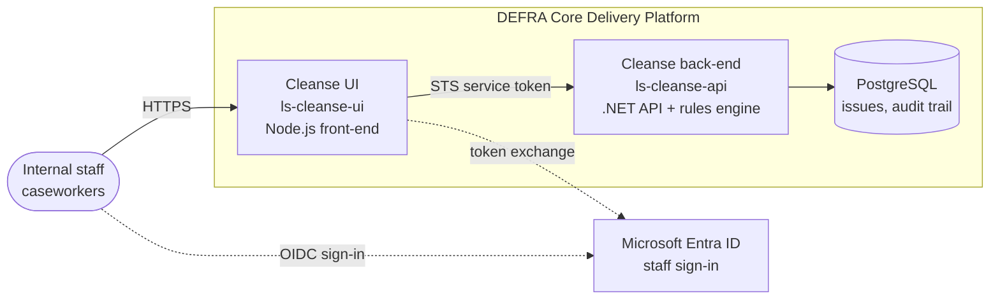

# Architecture

Cleanse supports the manual migration of livestock holding data from CTS (the legacy cattle
tracing system) to SAM, ahead of the expected closure of CTS. The Cleanse rules engine runs
overnight, detects anomalies and discrepancies between SAM and CTS data (read from the KRDS Data
Bridge) and records each one as an issue. Caseworkers triage the issues in the Cleanse UI, with
their triage state preserved across re-detections and a full audit trail.

## Diagram

## Components

- **Cleanse UI** (`ls-cleanse-ui`, this repository) — Node.js 24, Hapi and GOV.UK Frontend.
  Sign-in, the issues list and triage pages. Sessions are an encrypted browser cookie; it uses no
  Redis.
- **Cleanse back-end** ([`ls-cleanse-api`](https://github.com/DEFRA/ls-cleanse-api)) — ASP.NET
  Core (.NET 10) minimal API hosting the domain and the `cts-sam` rules engine (01:00 UTC daily
  and on demand). Reads the CTS and SAM read model from the KRDS Data Bridge
  (`ls-keeper-data-bridge-backend`).
- **PostgreSQL** — Aurora PostgreSQL with IAM authentication. Issues, workflow state, audit
  trail, issue history, rule runs and known users.
- **Microsoft Entra ID** — sign-in for internal staff (`AUTH_MODE=entra`), limited by
  enterprise-application assignment; see [ENTRA-AUTH.md](ENTRA-AUTH.md). A shared-password mode
  exists for environments without Entra.

## Notes

- The UI calls the back-end on its internal CDP URL with a short-lived AWS STS web-identity JWT;
  the back-end accepts only the `ls-cleanse-ui` service.
- Configuration lives in `DEFRA/cdp-app-config` and secrets in the CDP Portal. The database
  schema is applied through Portal → Apply Changelog; the running service has no DDL rights.
- Both services expose `GET /health`, log ECS-format JSON for OpenSearch, and send all outbound
  HTTP through the CDP Squid proxy.
