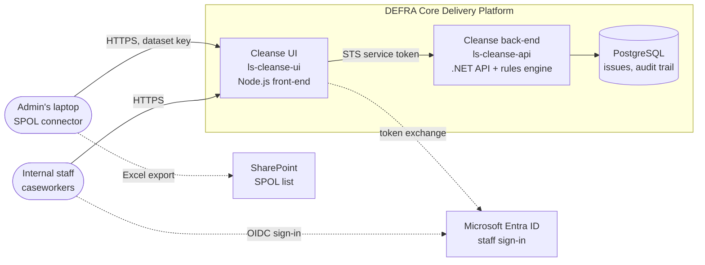

# Architecture

Cleanse supports the manual migration of livestock holding data from CTS (the legacy cattle
tracing system) to SAM, ahead of the expected closure of CTS. The Cleanse rules engine runs
overnight, detects anomalies and discrepancies between SAM and CTS data (read from the KRDS Data
Bridge) and records each one as an issue. Caseworkers triage the issues in the Cleanse UI, with
their triage state preserved across re-detections and a full audit trail.

## Diagram

## Components

- **Cleanse UI** (`ls-cleanse-ui`, this repository) — Node.js 24, Hapi and GOV.UK Frontend.
  Sign-in, the issues list, the holding page where caseworkers work a CPH's issues, and the admin
  pages. Sessions are an encrypted browser cookie; it uses no Redis.
- **Cleanse back-end** ([`ls-cleanse-api`](https://github.com/DEFRA/ls-cleanse-api)) — ASP.NET
  Core (.NET 10) minimal API hosting the domain and the `cts-sam` rules engine (01:00 UTC daily
  and on demand). Reads the CTS and SAM read model from the KRDS Data Bridge
  (`ls-keeper-data-bridge-backend`).
- **PostgreSQL** — Aurora PostgreSQL with IAM authentication. Issues, workflow state, holdings
  with their assignee, notes and recorded actions, the admin lists, audit trail, rule runs, SPOL
  datasets and known users.
- **SPOL connector** (`ls-cleanse-spol-connector`) — a PowerShell 7 script an admin runs on their
  Windows laptop. It exports the SPOL SharePoint list through Excel, with the admin's own
  Microsoft 365 sign-in, and sends it a page at a time to a SPOL dataset, through this UI, with
  the dataset's key. An admin then processes the dataset from the admin pages.
- **Microsoft Entra ID** — sign-in for internal staff in production (`AUTH_MODE=entra`), limited
  by enterprise-application assignment and the `cleanse-user` and `cleanse-admin` app roles. The UI
  proves its own identity to Entra with a CDP federated credential, so no client secret is stored;
  see [ENTRA-AUTH.md](ENTRA-AUTH.md). The other environments use the shared-password mode.

## Notes

- The UI calls the back-end on its internal CDP URL with a short-lived AWS STS web-identity JWT;
  the back-end accepts only the `ls-cleanse-ui` service.
- With Entra sign-in, each change to a holding or an admin list names the signed-in person in the
  `x-cleanse-user-id` header, so the back-end records it against them. With the shared password
  there is no one to name, so the change is recorded against the service.
- A CPH contains slashes, so it never goes in a back-end path. The holding page is
  `/holdings/01/036/8000`, and the UI passes the CPH to the back-end in the query string or the
  body.
- `/api/v1/datasets/{id}` is the only route without a sign-in or a form token. The connector calls
  it with a dataset's key in the `x-dataset-key` header, and the UI passes the request to the
  back-end, which checks the key. It takes only JSON, of up to 4 MB, answers only in JSON, and
  request logs leave the key out. Without a dataset's key it does nothing.
- Pages use JavaScript only to enhance what already works without it, except the admin dashboard
  (`/admin/dashboard`), which draws its charts as SVG in the browser with D3. It is a Vite entry
  of its own, `dashboard.js`, loaded only on that page and bundled with D3 at build time, so the
  content security policy is unchanged. The page carries its first figures in a JSON block, and
  later filter changes fetch `/admin/dashboard/data`. The figures come from the back-end's
  dashboard tables, which it rebuilds from the issue and holding history when that changes, not
  from the live tables on each request.
- Configuration lives in `DEFRA/cdp-app-config` and secrets in the CDP Portal. The database
  schema is applied through Portal → Apply Changelog; the running service has no DDL rights.
- Both services expose `GET /health`, log ECS-format JSON for OpenSearch, and send all outbound
  HTTP through the CDP Squid proxy.
